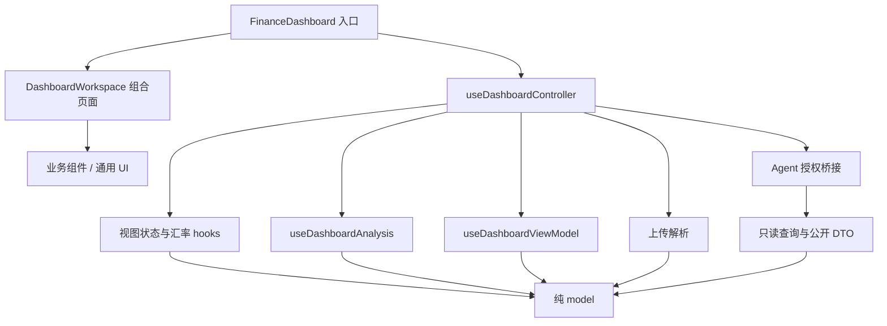

# 财务看板架构与验收记录

当前实现是单一业务 feature 内的分层结构。纯计算、状态转换、页面编排和展示
分别承担明确职责；不引入全局状态库、后端或新的 ESLint 规则。

## 依赖方向

`model` 不依赖 React、浏览器 API、图表库、hooks 或 components。
业务组件可依赖领域类型与计算 helpers；通用 `src/components` 不反向依赖业务
feature。只有 `DashboardWorkspace` 作为组合根接收完整 controller；子组件
声明自己需要的值和操作。

## 代码归属

| 位置 | 职责 | 不应承担的职责 |
| --- | --- | --- |
| `model/filters.ts`、`time-filter.ts` | 类型化筛选、统一日期边界 | 中文显示文案、读取系统时钟 |
| `model/dashboard-state.ts` | 筛选、下钻、排序、分页的原子状态转换 | 上传、DOM、React setter |
| `model/rate-inputs.ts` | 汇率草稿、有效计算值和校验 | 浏览器存储、行情请求 |
| `model/analytics/` | 指标、分组、期间比较、时间序列 | 生成逐笔明细、图表 options |
| `model/transaction-details.ts` | 按月/日选择明细、复盘元数据 | 默认预构造所有月份/日期的明细 |
| `hooks/use-dashboard-analysis.ts` | 分析结果的派生与缓存 | 排序、分页、图表下钻状态 |
| `hooks/use-dashboard-view-model.ts` | 排序、分页、图表数据投影、明细选择器 | 修改筛选或读取工作簿 |
| `hooks/use-dashboard-controller.ts` | 账本所有权、子流程连接、统一时间基准 | 堆积业务计算和逐个 UI setter |
| `upload/` | 文件边界、解析状态、工作簿映射 | 统计计算与授权规则 |
| `agent/` | 授权、输入校验、只读查询、公开 DTO | 引用页面 controller 类型、暴露逐笔交易 |
| `components/entry` | 入口页与上传卡片 | 已加载账本的指标 |
| `components/overview` | 账本概览、指标、环比/同比 | 上传状态机和领域规则 |
| `components/feedback` | 解析、拖放、警告和空状态 | 数据计算 |
| `components/shared` | 公用展示组件与徽标样式 | 领域交易分类规则 |

`analytics.ts` 保留为领域导出入口。模块按指标、分组、比较、时间序列拆分，
避免为了文件长度继续切碎完整算法。图表配置仍留在 `components/charts/options`。

## 状态与时间规则

筛选时间是 `all / year-to-date / rolling-months / year / custom` 判别联合，
不再用多个可冲突字段表示当前选择。中文标签只参与显示；清除筛选按稳定的
`FilterKey` 处理。

| 操作 | 筛选/下钻 | 排序/分页 | Agent 上下文 |
| --- | --- | --- | --- |
| 修改任意全局筛选 | 应用筛选，退出分类下钻 | 保留排序，回到第一页 | 更新 |
| 点击月份/分类/账户/标签 | 进入相应语义操作；纳入与排除标签互斥 | 回到第一页 | 更新 |
| 图表下钻、排行层级变化 | 仅改变图表视图 | 保留 | 保留 |
| 修改明细排序/每页条数 | 保留筛选 | 回到第一页 | 保留 |
| 翻页 | 保留 | 切换有效页 | 保留 |
| 无效汇率草稿 | 保留有效计算汇率 | 保留 | 保留 |
| 有效汇率值变化 | 更新计算值 | 保留 | 更新 |
| 重置筛选 | 清空筛选与下钻 | 保留排序和每页条数，回到第一页 | 更新 |
| 开始导入 | 旧账本待成功解析后替换 | 待解析结果 | 同步撤销授权 |
| 成功导入 | 清空筛选和下钻，初始化汇率 | 默认排序、第一页，保留每页条数 | 新上下文，需重新授权 |
| 导入失败 | 保留旧账本和视图 | 保留 | 授权保持关闭 |

controller 在账本、筛选或有效汇率变化时生成 `asOf`，页面分析与 Agent 快照
共用它。翻页、排序、编辑无效汇率不推进这个时刻，也不触发汇总重新计算。

自定义起止日期包含完整自然日；滚动月份保留本地时分秒和既有月末顺延行为，
例如 2024-03-31 回溯一个月得到 2024-03-02。同比继续保留闰日顺延行为。
这些是此次重构保留的口径；若以后改成月末截断，需要单独产品决策和测试。

Agent 的 `QueryFilters` DTO 继续输出 `quickRange/year/startDate/endDate`，
由适配函数转换内部时间联合，避免内部重构改变外部字段。月分组和支出分组
使用可区分的具体结果类型；汇总和比较也有明确 DTO。公开结果只含汇总信息。

## 按需明细

月度/每日汇总只包含金额、笔数和期间标识。打开月度复盘时计算最大支出与
最大分类；点进某月才选择该月明细并按日期倒序排列。每日收支仅为当前选中的
一天生成明细。交易表接收当前页记录和总数。

选择器依赖当前筛选结果与有效汇率，筛选/汇率变化后会刷新；关闭复盘时不
生成复盘元数据。Agent 使用相同汇总函数，不经过 UI 明细选择器。

## 分阶段提交

每阶段先通过测试、类型检查、现有 lint、生产构建和差异检查，再提交。

| 阶段 | 提交 | 内容 |
| --- | --- | --- |
| 1 | `f39a35e` | 固定交易规则、日期、汇率与统计口径，建立虚构数据基线 |
| 2 | `e8f3ffa` | 类型化筛选、统一时间边界、保留 Agent 筛选 DTO |
| 3 | `7fecb2e` | 状态语义操作、下钻失效修复、汇率原子更新 |
| 4 | `993c7da` | 汇总/明细分离、分析/展示分离、具体查询类型 |
| 5 | `b59d01e` | 目录归位、收窄 props、展示样式移出 model |
| 6 | 本文所在提交 | 集成验收、补充查询守卫测试、性能脚本与文档 |

## 验收与性能

2026-10-31 使用完全虚构的账本，在 Codex 内置浏览器实测开发服务和生产预览。
覆盖入口上传、月度复盘、单月/单日明细、筛选后回到第一页、下钻清理、汇率
无效输入、授权开关、过期上下文、换文件和解析失败撤销授权。四个只读工具
在生产预览中全部调用成功，缺失汇率的部分合计与页面一致。长期运行的开发
服务在目录重构后曾出现模块执行错误，重启后复测上下文和汇总查询正常。

额外用 10,000 条生成记录逐项比对重构前后的指标、分组、所有月/日汇总、
明细及复盘元数据，结果一致。静态导入检查覆盖 118 个生产 TS/TSX 文件，
未发现循环依赖、model 反向依赖或通用 UI 依赖业务 feature。

运行 `pnpm exec node scripts/benchmark-analytics.mjs` 可以复测。脚本只编译
纯 model 与虚构数据到临时目录，结束后清理；不读取用户账单，也不启动服务。
基线为阶段 1 提交，使用同一脚本、同一机器、Node 24.21.0，预热后取 9 次中位数。

下表为一次对照，单位毫秒，均为“重构前 → 重构后”：

| 记录数 | 主要汇总计算 | 关键词筛选+汇总 | 汇率变化后计算 | 准备单月明细 |
| ---: | ---: | ---: | ---: | ---: |
| 1,000 | 1.14 → 0.92 | 0.64 → 0.57 | 1.06 → 0.95 | 0.19 → 0.02 |
| 10,000 | 6.42 → 4.76 | 5.03 → 4.87 | 6.36 → 4.64 | 1.68 → 0.12 |
| 50,000 | 36.39 → 25.17 | 26.21 → 25.18 | 35.07 → 24.72 | 12.43 → 1.29 |

这是纯函数计算对照，不包含 Excel 解析、React 渲染和 ECharts 绘制。旧实现
的单月数据准备会生成所有月份的明细，新实现只生成选中月；该列不代表弹窗
端到端打开耗时。关键词筛选仍扫描所有记录，改善很小且容易受运行波动影响。

当前仍有多次线性扫描和明细排序，单页也仍是一个完整业务 feature。暂不引入
Worker、索引、全局事件总线或通用仓储层。后续应先依据实际浏览器性能证据
选择优化位置，保持现有依赖方向与测试覆盖。
